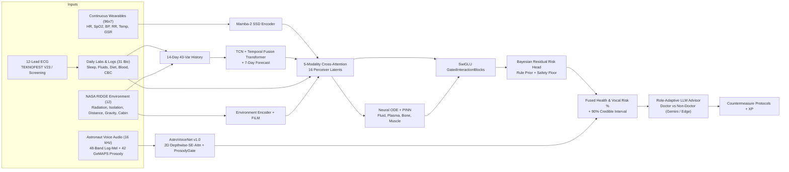
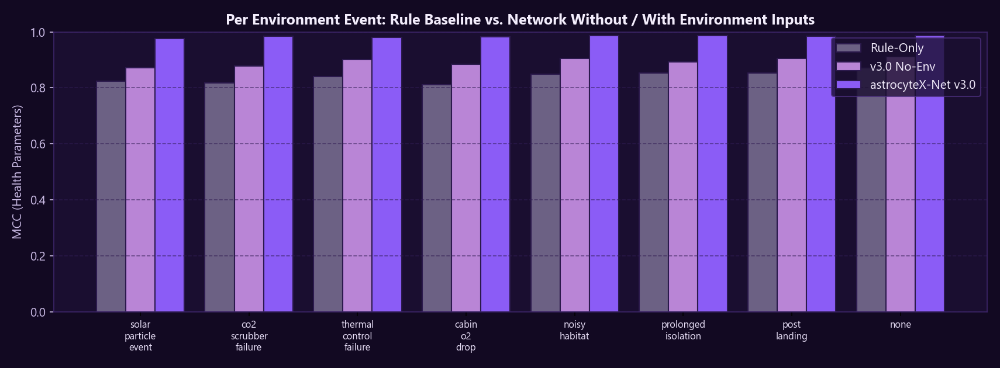
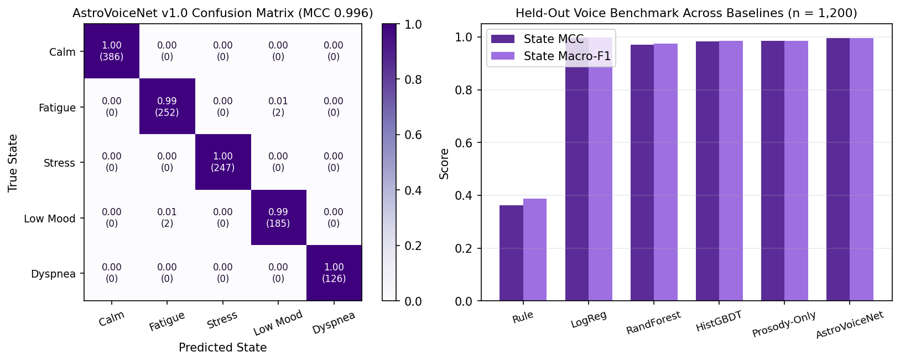

# AstrocyteX

**Autonomous Astronaut Health, Vocal Biomarker & Spaceflight-Hazard AI Telemetry Console** — developed for the **NASA Space Apps Challenge**.

**AstrocyteX (v3.0)** fuses continuous wearable sensors, daily clinical/biochemical/nutrition inputs, crew subjective logs, 12-lead ECG, **astronaut voice acoustics & psychological mood biomarkers (`AstroVoiceNet v1.0`)**, and **the five NASA spaceflight hazards** (*radiation, isolation & confinement, distance from Earth, gravity fields, hostile/closed habitats*) into a unified, uncertainty-aware risk architecture (`AstrocyteX-Net v3.0`). When any physiological biomarker, vocal marker, or habitat parameter drifts into the yellow, red, or black band, a **role-adaptive LLM advisor** (`"I am a doctor"` clinical aerospace-medicine mode vs `"I am not a doctor"` clear everyday crew mode — Gemini online, deterministic edge reasoner offline) synthesises actionable English countermeasures and rewards crew adherence with XP, ranks, streaks, and operational badges.

> **Disclaimer — Research & demonstration software (not a medical device).** Reference ranges are illustrative, neural networks are trained on simulated spaceflight cohorts, and space-physiology constants are not clinically validated. Never use this software for real clinical diagnosis or treatment.

---

## Key Capabilities (v3.0)

| Subsystem | Technical Specification |
|---|---|
| **Dark-Purple Milky Way Telemetry UI** | Restrained two-column aerospace flight-medical workstation (`web/` & `ui/`) over a photorealistic view of the Milky Way galaxy from Earth (`web/milky_way_earth.jpg`), flat `1px` neutral-bordered obsidian panels, tabular monospace readouts, pure English web interface with bottom-left Quick Guide, and a strict **100% zero-emoji** design policy |
| **43 Monitored Telemetry Parameters** | **31 physiological biomarkers** (wearables, sleep, hydration, urine/saliva strips, ARED/treadmill exercise, blood chemistry, complete blood count, nutrition, 12-lead ECG) + **12 NASA RIDGE spaceflight hazards** |
| **Astronaut Voice Psychological & Mood Analysis** | Interactive browser microphone recorder (16 kHz PCM `.wav`), multi-format audio uploader (`.wav`, `.mp3`, `.m4a`, `.ogg`, `.webm`, `.npy`, `.csv`), and playable astronaut voice presets powered by **`AstroVoiceNet v1.0`** (`(48, 64)` log-Mel spectrogram + `42` GeMAPS-inspired prosodic biomarkers) predicting 5 psychological states, 4 mood dimensions (`valence`, `arousal`, `stress`, `fatigue`), and `0-100%` vocal risk fused into overall health risk |
| **Role-Adaptive LLM Communication** | Selectable **`"I am a doctor"` (`doctor`)** vs **`"I am not a doctor"` (`non_doctor`)** profile across both assessments and interactive chat — delivering quantitative aerospace pathophysiology (`F0`, `jitter`, `shimmer`, `HNR`, `QTc`, cephalad shift, counterfactual uplift) for physicians, or calm jargon-free guidance for crew members |
| **Upgraded Multimodal Neural Backbone** | **`AstrocyteX-Net v3.0`** (`d_model=80`, `16` Perceiver latents, `SwiGLU GatedInteractionBlock`s): Mamba-2 SSD + TCN/TFT + Environment Encoder & FiLM + 5-Modality Cross-Attention + Neural ODE/PINN + Bayes-by-Backprop & MC-Dropout residual risk head |
| **12-Lead ECG Integration** | Adapter for the **TEKNOFEST V23 12-lead ECG AI** (10 arrhythmia/conduction classes, QTc, abnormal probability) with automatic offline R-peak screening fallback |
| **Edge-First Autonomy & Gamification** | Operates 100% offline under deep-space communication delays; awards severity-scaled XP, rank promotions (`Cadet` to `Fleet Admiral`), streaks, and 18 operational badges |

---

## Multimodal Architecture



---

## Quick Start

Requires **Python 3.10+** (tested on Python 3.13.7 + PyTorch 2.8 + CUDA 12.6).

```powershell
# Launch AstrocyteX Dark-Purple Milky Way Web Console + FastAPI Backend (http://localhost:8501)
.\.venv\Scripts\python.exe run.py ui

# Launch secondary Streamlit Telemetry Console
.\.venv\Scripts\python.exe run.py streamlit

# Retrain neural models on GPU & re-run held-out benchmarks
.\.venv\Scripts\python.exe run.py train-voice
.\.venv\Scripts\python.exe run.py train
.\.venv\Scripts\python.exe run.py evaluate

# Generate Turkish AI Summary & Citation Report (.docx + .md)
.\.venv\Scripts\python.exe scripts/generate_word_report.py

# Run full automated test suite
.\.venv\Scripts\python.exe run.py test
```

---

## Held-Out Performance Benchmarks

Detailed tables, 1,000-resample bootstrap 95% confidence intervals, subgroup slices, and confusion matrices are auto-generated in [`docs/MODEL_EVALUATION.md`](docs/MODEL_EVALUATION.md), [`docs/ASTROCYTEX_AI_OZET_RAPORU.md`](docs/ASTROCYTEX_AI_OZET_RAPORU.md), and [`docs/voice_evaluation.json`](docs/voice_evaluation.json):

- **`AstroVoiceNet v1.0` (1,200 unseen test voice clips, 4,000 training clips):**
  - 5-Class Psychological State **MCC = `0.9957`** (`95% CI [0.9914, 0.9989]`), **Macro-F1 = `0.9963`**, **Accuracy = `99.67%`**.
  - Continuous Voice Risk **MAE = `3.168` pts** (`RMSE = 3.948` pts, **QWK = `0.9674`**), 4-Dimension Mood **MAE = `3.683` pts**, GPU latency **`2.41 ms/clip`**.
- **`AstrocyteX-Net v3.0` (6,000 unseen crew-days = 258,000 parameter predictions, 42,000 training crew-days, 2,976,783 parameters):**
  - **All 43 parameters:** **MCC = `0.9894`** (`95% CI [0.9889, 0.9899]`), **Macro-F1 = `0.9899`**, **QWK = `0.9958`**, **Critical Recall = `99.53%`** (Under-Triage `0.47%` vs `11.97%` Rule-only), **MAE = `0.144` pts** (nearly halving v2.0's `0.274` MAE).
  - **31 physiological biomarkers only (environment ablation):** **MCC = `0.9850`** (`95% CI [0.9843, 0.9857]`, Crit Recall `98.95%`, MAE `0.185` pts) vs No-Environment ablation `0.9040` (`+0.0810` MCC gain from 12 NASA RIDGE hazard channels, `p < 0.001`), Ridge `0.9358`, and MLP `0.9374` (see [`docs/MODEL_EVALUATION.md`](docs/MODEL_EVALUATION.md)).





---

## REST API Endpoints

| Method & Endpoint | Description |
|---|---|
| `POST /astronauts/{id}/assess?lang=en\|tr` | Full multimodal assessment (`values`, `sensor_series`, `subjective_log`, `ecg`, `voice`, `user_role`) |
| `POST /astronauts/{id}/chat?lang=en\|tr` | Role-adaptive (`doctor` / `non_doctor`) Q&A over latest crew telemetry and voice state |
| `POST /voice/analyze?lang=en\|tr&role=doctor\|non_doctor` | Upload `.wav` / `.npy` / `.csv` voice clip for `AstroVoiceNet v1.0` psychological & mood inference |
| `GET /voice/sample/{state_name}` | Synthesise & analyse playable reference astronaut voice clip (`calm_regulated`, `cognitive_fatigue`, `acute_stress`, `low_mood_isolation`, `dyspnea_hypoxic`) |
| `GET /voice/status` | Voice neural engine status & validation metrics |
| `POST /ecg/analyze` / `GET /ecg/sample/{CLASS}` | 12-lead ECG analysis (`NORMAL`, `AFIB`, `MI`, `PVC`, ...) |
| `GET /astronauts/{id}/tasks` / `POST .../complete` | Active countermeasure protocols & idempotent XP/badge completion |
| `GET /parameters` / `GET /presets` / `GET /health` | 43-parameter registry, mission profiles, scenarios, and subsystem health |

---

## Software Stack & Citations

Full software versions, open-source licences, and 28 peer-reviewed references (Dao & Gu Mamba-2, Lim et al. TFT, Jaegle et al. Perceiver, Perez et al. FiLM, Shazeer SwiGLU, Chen et al. Neural ODE, Raissi et al. PINN, Blundell et al. Bayes-by-Backprop, Gal & Ghahramani MC-Dropout, Eyben et al. GeMAPS, Hu et al. SE-Net, Klatt Formant Synthesis, Russell Circumplex Affect, Cao et al. CORAL, Chicco & Jurman MCC, NASA-STD-3001, Paszke et al. PyTorch, Pedregosa et al. scikit-learn) are documented in [`THIRD_PARTY_NOTICES.md`](THIRD_PARTY_NOTICES.md) and [`docs/ASTROCYTEX_AI_OZET_RAPORU.md`](docs/ASTROCYTEX_AI_OZET_RAPORU.md).
