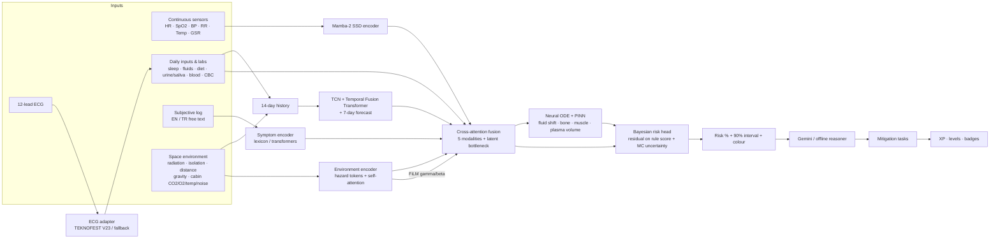
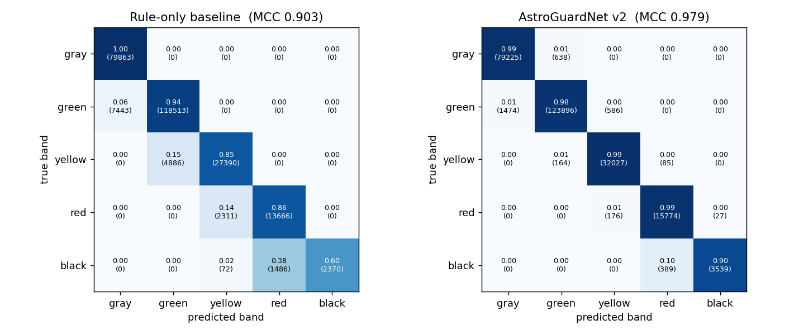

# 🛰️ AstroGuard-X

**AI-powered astronaut health monitoring with a built-in gamified mitigation system** — built for the
**NASA Space Apps Challenge**.

AstroGuard-X fuses continuous wearable sensors, daily lab/diet/sleep inputs, the astronaut's own words, a
12-lead ECG **and the space environment itself** (NASA's five hazards: radiation, isolation & confinement, distance
from Earth, gravity fields, hostile/closed habitat) into a single, uncertainty-aware risk picture. When something
drifts (yellow, red or black), an AI (Gemini online, a rule-based reasoner offline) writes concrete mitigation tasks — *"Drink 500 ml electrolyte
water"*, *"Perform 15 min ARED resistance exercise"*, *"Move to the radiation storm shelter"* — and
the crew member earns XP, levels, streaks and badges for completing them.

> ⚠️ **Research / demonstration software — not a medical device.** Reference ranges are illustrative, the neural
> networks are trained on **simulated** crews (no public dataset covers this parameter set) and the
> space-physiology constants are not clinically validated. See [Limitations](#limitations--honest-notes).

---

## Contents
[Features](#features) · [Architecture](#architecture) · [Quick start](#quick-start) · [Space environment](#space-environment-nasa-ridge-hazards) ·
[ECG integration](#ecg-integration-teknofest-v23) · [Gemini](#gemini-reasoning) · [Risk indicators](#risk-indicators) ·
[Gamification](#tasks--gamification) · [REST API](#rest-api) · [Project layout](#project-layout) · [Models](#the-models) ·
[Evaluation](#evaluation-held-out-test) · [Testing](#testing) · [Deployment](#deployment) ·
[Publish to GitHub](#publish-to-github) · [Limitations](#limitations--honest-notes) · [Credits](#open-source-attributions)

## Features

| Area | What you get |
|---|---|
| **43 monitored parameters** | 31 physiological — uyku saatleri · sıvı tüketimi · idrar/tükürük testleri · egzersiz süresi · EKG · kalp ritmi / nabız · kan basıncı · biyokimyasal değerler · hemogram · SpO₂ · solunum hızı · GSR · vücut sıcaklığı · beslenme ve diyet — **plus 12 space-environment hazards** (radiation, isolation & confinement, distance from Earth, gravity fields, closed-habitat air) — each with unit, normal range and live percentage risk |
| **Environment-aware AI** | the network learns how each hazard changes physiological risk (CO₂ → breathing, radiation storm → blood counts, landing → orthostatic intolerance, distance → no evacuation); dashboard shows a hazard index, the 5 RIDGE themes and a counterfactual *environmental risk uplift* |
| **Risk indicator circles** | ⚪ gray < 15 % · 🟢 green 15–40 % · 🟡 yellow 40–70 % · 🔴 red 70–90 % · ⚫ black > 90 % — next to *every* value (data entry **and** dashboard) |
| **AI task generator** | Any yellow/red/black parameter or hazard ⇒ specific, actionable tasks (Gemini structured output → validated → offline fallback) |
| **Gamification** | Points scaled by severity, live XP bar, levels & ranks, day streaks, 18 badges, level-up celebration |
| **Neural stack** | Mamba-2 · TCN + TFT · environment encoder + FiLM · cross-attention fusion · Neural ODE + PINN · Bayesian uncertainty |
| **ECG adapter** | Plug-in for the **TEKNOFEST V23 ECG analyser** (10-class, 12-lead) with offline screening fallback |
| **Edge-first** | Everything works without internet; Gemini is optional and guarded by a circuit breaker |
| **Bilingual UI** | English / Türkçe |
| **Two deployment modes** | Single-process Streamlit, or FastAPI backend + Streamlit (Docker Compose) |

## Architecture



**How the displayed risk is computed.** `risk = a·rule + (1−a)·model` with `a = 0.20` (configurable).
`rule` is the transparent reference-range score; `model` is the Monte-Carlo mean of the network, which learns
*interactions* on top of it (poor sleep + stress markers, symptoms in the log, trends…). A **safety floor** guarantees
that a red/black range alert can never be softened by the AI. Hover a row in the dashboard to see rule vs. model.

## Quick start

Requires **Python 3.10+**. No GPU needed.

```powershell
# Clone & enter repository
git clone https://github.com/icelberk-dotcom/NASA-space-apps-Ondankoymacano.git
cd NASA-space-apps-Ondankoymacano

# Windows - creates .venv, installs deps, trains the compact model, runs tests, initialises git
powershell -ExecutionPolicy Bypass -File scripts\setup.ps1
.\.venv\Scripts\python.exe run.py ui          # dashboard  -> http://localhost:8501
.\.venv\Scripts\python.exe run.py api         # REST API   -> http://localhost:8000/docs
```

```bash
# Linux / macOS
bash scripts/setup.sh            # add --gpu to try the fused mamba-ssm CUDA kernels
.venv/bin/python run.py ui
```

`python run.py all` starts the API and a dashboard that talks to it. Other commands: `train`, `evaluate`, `test`, `ecg`.
If no checkpoint exists the backend trains a compact model on first start (`ASTROGUARD_AUTOTRAIN=1`).

Try it: *Data entry → Demo scenario → "dehydration" → Load scenario → Run AI assessment* — circles turn
yellow/red, tasks appear under **Missions & rewards**; tick them to fill the XP bar. Then pick a **mission profile**
(sidebar, e.g. *Mars transit*) or an **environment event** (e.g. *Solar particle event*) and run again.

## Space environment (NASA RIDGE hazards)

NASA's Human Research Program groups the hazards of spaceflight into five categories — **R**adiation, **I**solation &
confinement, **D**istance from Earth, **G**ravity fields and hostile/closed **E**nvironments. AstroGuard-X takes each of
them as measurable inputs (`utils/reference_ranges.py`, environment block):

| Theme | Parameters (unit) | Normal → danger anchors (illustrative) |
|---|---|---|
| ☢️ Radiation | dose rate (mSv/day) · cumulative mission dose (mSv) | ≤ 1 → 20 mSv/d (solar particle event) · ≤ 150 → 600 mSv (NASA career limit) |
| 🔒 Isolation & confinement | isolation duration (days) · habitable volume per crew member (m³) | ≤ 90 → 365 d · ≥ 25 → 4 m³ |
| 🌍 Distance from Earth | distance (10⁶ km) → derived one-way light delay & time to definitive care | ≤ 1 (cislunar) → 400 (Mars far side) |
| 🪐 Gravity fields | gravity level (g) · days since the last gravity transition | 0 g = red (managed daily), Mars yellow, Earth gray · ≥ 14 → 1 day after landing |
| 🌫️ Hostile / closed habitat | cabin CO₂ (mmHg) · cabin O₂ (kPa) · temperature (°C) · humidity (%) · noise (dBA) | e.g. CO₂ ≤ 3 → 8 mmHg, noise ≤ 60 → 85 dBA |

How the environment enters the assessment:

1. **Own hazard level** — every environment parameter gets a % and a coloured circle and can trigger tasks
   (*"Move to the radiation storm shelter"*, *"Check the CO₂ scrubber and increase ventilation"*, *"Fluid-load before
   standing"*). They form a separate **environment hazard index** and are *not* counted as illness: the overall
   **health** risk aggregates the 31 physiological parameters only.
2. **Learned interactions** — the network has a dedicated *environment encoder* (hazard tokens from z-score + hazard
   risk, self-attention between hazards), a fifth fusion modality and a **FiLM** layer that modulates the fused
   physiology representation. It is trained on simulated crews in six mission profiles (Earth analog, ISS, Gateway,
   lunar surface, Mars transit, Mars surface) with seven off-nominal events, where hazards physically shift
   physiology and an explicit interaction prior (`ENV_COUPLING`, `DIST_AMPLIFIER` in `utils/synthetic_data.py`)
   defines how much risk they add.
3. **Counterfactual environmental uplift** — the service re-evaluates the same data in a benign Earth-like
   environment; the difference ("+X points") and the most affected parameters are shown on the dashboard and
   passed to Gemini, together with the communication delay (the advisor tells the crew to act autonomously when
   the delay is long).

## ECG integration (TEKNOFEST V23)

`backend/ecg_adapter.py` integrates the 12-lead ECG analyser built for **TEKNOFEST 2026**
(*OmniNet Apex-Titan V23*: dipole kinematics, 52 biomarkers, Sgarbossa/STEMI matrix, ST-GNN, Swin-1D, Bi-Mamba) —
the Antigravity-built Flask app — **without modifying it**. Its 138 MB weights exceed GitHub's file limit, so
the package stays on your machine and is referenced by path:

```ini
# .env
ECG_PACKAGE_PATH=C:\path\to\EKG_Yapay_Zeka_Flash_Bellek_Paketi    # folder with TEKNOFEST_EKG_Yapay_Zeka_Sistemi.py
ECG_PYTHON=C:\path\to\python.exe                                    # optional: interpreter that has torch + flask
```

Resolution order per request: (1) a service already running on `ECG_SERVICE_URL` → (2) the adapter launches the package
(`--no-browser --port 5057`) as a managed child process and waits for `/api/health` → (3) a clearly labelled built-in
screening analyser (R-peak detection: HR, regularity, HRV) so the platform keeps working offline.

In the **ECG tab** upload `.npy/.npz/.csv/.mat/.dat` or run one of the package's 10 clinical demo classes
(NORMAL, AFIB, AFL, LBBB, RBBB, MI, PVC, PAC, AVB, STTC). **Apply to dashboard values** writes
`ecg_abnormal_pct` (= 100 − P(normal)), `ecg_qtc_ms` and the heart rate into the form, so the ECG takes part in risk
scoring, task generation and the Gemini briefing. Verified live against the V23 package (e.g. AFIB demo → AFIB 99.97 %).

## Gemini reasoning

Uses the official **Google GenAI SDK** (`google-genai`). Put a key in `.env` (`GEMINI_API_KEY`, get one at
<https://aistudio.google.com/apikey>). Gemini receives risks, values, symptoms, forecast and physics projections and
must answer with JSON matching `AdvisorOutput` (summary, recommendations, tasks). Output is **validated and sanitised**
(only at-risk parameters, bounded durations, duplicates removed, gaps filled from the library). No key / no network /
timeout ⇒ the offline reasoner (`backend/task_library.py`: tasks for every parameter and direction) takes over for a
minute (circuit breaker). The system prompt forbids diagnoses and drug dosing.

## Risk indicators

Each parameter has an *ideal* value and normal / caution / danger limits (`utils/reference_ranges.py`). The score is a
piece-wise-linear interpolation: ideal → 8 %, normal limit → 40 %, caution limit → 70 %, danger limit → 90 %, beyond → 100 %.

| Colour | Risk | Meaning |
|---|---|---|
| ⚪ Gray | < 15 % | Normal / baseline / inactive (also: no data yet) |
| 🟢 Green | 15 – 40 % | Low risk / normal range |
| 🟡 Yellow | 40 – 70 % | Minor deviation → tasks generated |
| 🔴 Red | 70 – 90 % | High risk → tasks generated |
| ⚫ Black | > 90 % | Immediate intervention → tasks + "contact flight surgeon" |

## Tasks & gamification

* Points: yellow 10 · red 25 · black 50, plus up to +12 for longer tasks. Each task pays out **once** (atomic, idempotent).
* Level *L* starts at `60·(L−1)²` XP; ranks Cadet → Fleet Admiral; the sidebar and Missions tab show a live progress bar.
* Streak = consecutive UTC days with ≥ 1 completed task.
* 18 badges, e.g. *Hydration Hero*, *Iron Lungs*, *Bone Guardian*, *Storm Shelter*, *Habitat Keeper*, *Code Black Survivor*.
* Tasks are not duplicated while open; they are re-issued only if a parameter gets *worse*.

## REST API

`python run.py api` → interactive docs at `/docs`.

| Method & path | Purpose |
|---|---|
| `POST /astronauts/{id}/assess?lang=en\|tr` | run a full assessment (values incl. environment, sensor series, log, ECG) → health risk, environment block, tasks, briefing |
| `GET /astronauts/{id}/latest` · `/history` | last assessment · overall-risk history |
| `GET /astronauts/{id}/tasks?status=pending\|done` | task list |
| `POST /astronauts/{id}/tasks/{task_id}/complete` | complete a task → points, level-up, new badges |
| `GET /astronauts/{id}/gamification` | XP, level, rank, streak, badges |
| `POST /astronauts/{id}/chat` | ask the advisor |
| `POST /ecg/analyze` · `GET /ecg/sample/{CLASS}` · `GET /ecg/status` | ECG adapter |
| `GET /environment/profiles?mission_day=90` | mission profiles (ISS, Gateway, Moon, Mars …) with environment values + off-nominal events |
| `GET /parameters` · `/health` · `/badges` | registry, status |

## Project layout

```
AstroGuard-X/
├── backend/
│   ├── main.py            FastAPI app
│   ├── service.py         orchestration: features → model → blend → environment uplift → tasks → persistence
│   ├── ecg_adapter.py     TEKNOFEST V23 ECG integration + offline screening fallback
│   ├── gemini_agent.py    Google GenAI SDK client, offline reasoner, output sanitiser
│   ├── task_library.py    offline mitigation-task knowledge base (physiology + environment hazards)
│   ├── gamification.py    XP, levels, streaks, badges
│   ├── storage.py         SQLite persistence
│   └── schemas.py         Pydantic models
├── models/
│   ├── mamba2.py          Mamba-2 (SSD) encoder, pure PyTorch (+ optional mamba-ssm)
│   ├── tcn_tft.py         TCN + Temporal Fusion Transformer trend encoder (batched variable GRNs)
│   ├── environment.py     environment-hazard encoder + FiLM conditioning
│   ├── fusion.py          cross-attention multimodal fusion (5 modalities)
│   ├── physics.py         Neural ODE + PINN (fluid shift, bone, muscle, plasma volume)
│   ├── uncertainty.py     Bayesian layers, MC dropout, aleatoric/epistemic split
│   ├── rule_prior.py      differentiable reference-range score (residual-learning base)
│   ├── astroguard.py      the full network (v2)
│   ├── train.py           GPU training: EMA, ordinal band loss, early stopping on validation MCC
│   ├── metrics.py         MCC / macro-F1 / QWK / safety metrics + crew-day bootstrap
│   └── evaluate.py        held-out test, baselines, ablation, slices → docs/MODEL_EVALUATION.md
├── ui/                    Streamlit dashboard (app.py, components.py, theme.py, i18n.py, client.py)
├── utils/                 reference_ranges.py · environment.py · features.py · synthetic_data.py · subjective.py · telemetry.py · ecg_synth.py · config.py
├── docs/                  MODEL_EVALUATION.md · model_evaluation.json · img/ · ABOUT_UI.md · ci.yml
├── scripts/               setup.ps1 · setup.sh · publish_github.ps1 · publish_github.sh · git_init_fallback.py
├── tests/                 pytest suite (models, ranges, environment, metrics, gamification, service, API, ECG, UI)
├── run.py                 launcher (ui | api | all | train | evaluate | test | ecg)
├── requirements*.txt · Dockerfile · docker-compose.yml · .env.example · LICENSE · THIRD_PARTY_NOTICES.md
```

## The models

| Component | Implementation | Role |
|---|---|---|
| **Mamba-2** | `models/mamba2.py` — chunked state-space-duality scan (validated against the step-by-step recurrence), causal conv, gated RMSNorm; swaps to `mamba-ssm` on CUDA | continuous HR / SpO₂ / BP / RR / temp / GSR window |
| **TCN + TFT** | `models/tcn_tft.py` — dilated causal convs, Variable Selection (43 variables, batched GRNs), LSTM, interpretable multi-head attention, 7-day forecast head | 14-day physiological + environment trend |
| **Environment encoder + FiLM** | `models/environment.py` — one token per hazard from [z-score, hazard risk], self-attention between hazards, attention pooling, FiLM γ/β modulation of the fused state | radiation · isolation · distance · gravity · habitat |
| **Cross-attention fusion** | `models/fusion.py` — daily & subjective tokens read sensor/trend/environment context, then Perceiver-style latent bottleneck; returns per-modality attention | combines 5 modalities |
| **Neural ODE + PINN** | `models/physics.py` — physics prior (fluid shift, plasma volume, bone, muscle) + bounded neural correction, RK4; PINN residual, collocation and constraint losses; gravity from the environment input | space-physiology projections (+30/90/180 days) |
| **Bayesian UQ** | `models/uncertainty.py` — Bayes-by-Backprop head, MC-dropout, heteroscedastic NLL → epistemic / aleatoric / 90 % interval | robust risk estimates |
| **Gemini** | `backend/gemini_agent.py` — `google-genai`, structured JSON output, environment-aware prompt | briefing + tasks |

Training (`python -m models.train --samples 32000 --epochs 45`, ~1.7 M parameters, CUDA GPU if available) uses simulated
crews: 11 clinical scenarios + mixtures ramping over 21 days, 6 mission profiles and 7 off-nominal environment events,
person-specific offsets, circadian sensor streams, bilingual subjective logs and hidden physiology multipliers that leak
into biomarkers. Targets are the transparent range-based risks plus documented interaction priors (`COUPLING`,
`SYMPTOM_COUPLING`, `ENV_COUPLING`, `DIST_AMPLIFIER` in `utils/synthetic_data.py`). Recipe: AdamW + OneCycle, KL
annealing, an **ordinal band loss** at the 15/40/70/90 % colour thresholds (higher weight on red/black), an **EMA** of
the weights and early stopping on validation MCC.

## Evaluation (held-out test)

Evaluated on **6,000 unseen simulated crew-days** (seed `424242`, disjoint from training/validation; **258,000** parameter-level predictions across strongly imbalanced bands: gray 79,863 · green 125,956 · yellow 32,276 · red 15,977 · black 3,928) with **1,000 whole-crew-day bootstrap resamples** (`python run.py evaluate` → [`docs/MODEL_EVALUATION.md`](docs/MODEL_EVALUATION.md)).

Why **Multi-class MCC** + **Macro-F1** + **Quadratic Weighted Kappa (QWK)** + **Critical Recall**: plain accuracy is inflated by normal `gray`/`green` readings; **MCC** uses the entire $5\times 5$ confusion matrix and is high only when every band performs well, **Macro-F1** weights rare `black` alarms equally with `gray`, **QWK** penalises multi-band errors quadratically, and **Critical Recall / Under-Triage** measures missed `red`/`black` alerts directly.

**All 43 parameters (held-out test set):**

| System | MCC [95 % CI] | Macro-F1 [95 % CI] | QWK | Critical recall | Under-triage | Actionable F1 | MAE (pp) |
|---|---|---|---|---|---|---|---|
| Rule-only (reference ranges) | 0.9032 [0.9016–0.9047] | 0.8839 [0.8808–0.8872] | 0.9599 | 0.8803 | 0.1197 | 0.9509 | 1.494 |
| Ridge residual (scikit-learn) | 0.9550 [0.9540–0.9560] | 0.9485 [0.9466–0.9504] | 0.9824 | 0.9890 | 0.0110 | 0.9775 | 0.622 |
| **AstroGuardNet v2** | **0.9788** [0.9782–0.9796] | **0.9767** [0.9752–0.9781] | **0.9916** | **0.9912** | **0.0088** | **0.9928** | **0.274** |
| Deployed blend (0.20 rule + 0.80 model, safety floor) | 0.9680 [0.9672–0.9689] | 0.9570 [0.9548–0.9590] | 0.9872 | 0.9670 | 0.0330 | 0.9903 | 0.444 |

**31 physiological health biomarkers only (fair environment-hazard ablation):**

| System | MCC [95 % CI] | Macro-F1 [95 % CI] | QWK | Critical recall | Under-triage | MAE (pp) |
|---|---|---|---|---|---|---|
| Rule-only (reference ranges) | 0.8588 [0.8564–0.8609] | 0.7809 [0.7754–0.7868] | 0.9306 | 0.7286 | 0.2714 | 2.061 |
| Ablation: v2 *without* environment inputs | 0.8977 [0.8959–0.8997] | 0.8527 [0.8478–0.8576] | 0.9515 | 0.8321 | 0.1679 | 1.441 |
| Ridge residual (scikit-learn, with env) | 0.9358 [0.9343–0.9372] | 0.9141 [0.9109–0.9170] | 0.9713 | 0.9792 | 0.0208 | 0.837 |
| **AstroGuardNet v2 (with 12 RIDGE hazards)** | **0.9701** [0.9692–0.9712] | **0.9611** [0.9584–0.9635] | **0.9864** | **0.9801** | **0.0199** | **0.353** |

Paired bootstrap significance ($P(\Delta\text{MCC} \le 0) < 0.001$ for every comparison): adding the 12 NASA RIDGE environment inputs boosts physiological biomarker MCC by **+0.0724** (`95 % CI [+0.0707, +0.0742]`) and cuts missed critical physiological alarms from **16.8 % → 2.0 %** (+14.8 percentage points critical recall). See [`docs/MODEL_EVALUATION.md`](docs/MODEL_EVALUATION.md) for per-event and per-mission-profile slices.




## Testing

```bash
python run.py test        # or: pytest -q
```

The suite (185+ tests) checks, among others: SSD scan == naive recurrence · RK4 vs. closed-form physics · PINN losses differentiable ·
torch rule score == NumPy rule score · exact colour boundaries (<15 / 15–40 / 40–70 / 70–90 / >90) · monotone risk curves for
all 43 parameters · environment risk mapping, interaction prior and side-specific hazards · health risk excludes environment ·
MCC / macro-F1 / QWK == scikit-learn · task generation, de-duplication and escalation · idempotent XP · safety floor · REST flow ·
ECG adapter fallback and payload mapping · Gemini output sanitiser & circuit breaker · the Streamlit UI end-to-end (AppTest).

## Deployment

```bash
docker compose up --build        # API :8000, UI :8501 (UI talks to the API via ASTROGUARD_API_URL)
```

To use the ECG package in Docker, mount it (see comments in `docker-compose.yml`) and set `ECG_PACKAGE_PATH`.
Streamlit Community Cloud also works (`ui/app.py`, in-process mode; the compact model trains on first start).

## Publish to GitHub

```powershell
scripts\publish_github.ps1 -Repo NASA-space-apps-Ondankoymacano                                                    # needs GitHub CLI (gh auth login)
scripts\publish_github.ps1 -RemoteUrl https://github.com/icelberk-dotcom/NASA-space-apps-Ondankoymacano.git        # or push directly to a remote repo
```
```bash
bash scripts/publish_github.sh NASA-space-apps-Ondankoymacano          # or: REMOTE_URL=https://github.com/icelberk-dotcom/NASA-space-apps-Ondankoymacano.git bash scripts/publish_github.sh
```

The scripts commit, **refuse to push if `.env` is tracked or an API key pattern is found**, then create/push a public
repository. `.gitignore` excludes `.env`, databases, trained weights and the third-party ECG package.

## Limitations & honest notes

* **Not validated medically.** Reference ranges are generic adult values; physics constants are simplified published trends.
* **Simulated training data.** Reported validation metrics measure agreement with the *simulator's* targets, not clinical accuracy.
  Real use would require flight/analog data, calibration and regulatory review.
* **Rule-anchored by design.** The network can add concern (interactions, symptoms, trends) but a red/black range alert is never softened.
* **ECG.** The TEKNOFEST model's results are shown as produced by that package; the built-in fallback is a screening heuristic, not a classifier.
  The synthetic demo ECG used for tests is not a clinically meaningful signal.
* **Gemini** answers are advisory text, validated structurally — review them before acting.
* The pure-PyTorch Mamba-2 is slower than the fused CUDA kernel but numerically equivalent in design.

## Open-source attributions

PyTorch · mamba-ssm · Hugging Face transformers · Google GenAI SDK (`google-genai`) · Streamlit · Plotly · scikit-learn ·
NumPy · SciPy · pandas · FastAPI · Pydantic · Uvicorn · Requests · python-dotenv — with papers and licences in
[`THIRD_PARTY_NOTICES.md`](THIRD_PARTY_NOTICES.md). Code is released under the [MIT License](LICENSE).
Created for the NASA Space Apps Challenge; not endorsed by NASA.
