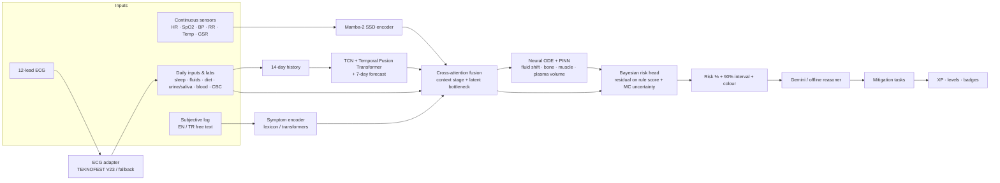

# 🛰️ AstroGuard-X

**AI-powered astronaut health monitoring with a built-in gamified mitigation system** — built for the
**NASA Space Apps Challenge**.

AstroGuard-X fuses continuous wearable sensors, daily lab/diet/sleep inputs, the astronaut's own words and a
12-lead ECG into a single, uncertainty-aware risk picture. When something drifts (yellow, red or black),
an AI (Gemini online, a rule-based reasoner offline) writes concrete mitigation tasks — *"Drink 500 ml electrolyte
water"*, *"Perform 15 min ARED resistance exercise"*, *"Take a 20-minute guided breathing session"* — and
the crew member earns XP, levels, streaks and badges for completing them.

> ⚠️ **Research / demonstration software — not a medical device.** Reference ranges are illustrative, the neural
> networks are trained on **simulated** crews (no public dataset covers this parameter set) and the
> space-physiology constants are not clinically validated. See [Limitations](#limitations--honest-notes).

---

## Contents
[Features](#features) · [Architecture](#architecture) · [Quick start](#quick-start) · [ECG integration](#ecg-integration-teknofest-v23) ·
[Gemini](#gemini-reasoning) · [Risk indicators](#risk-indicators) · [Gamification](#tasks--gamification) · [REST API](#rest-api) ·
[Project layout](#project-layout) · [Models](#the-models) · [Testing](#testing) · [Deployment](#deployment) ·
[Publish to GitHub](#publish-to-github) · [Limitations](#limitations--honest-notes) · [Credits](#open-source-attributions)

## Features

| Area | What you get |
|---|---|
| **31 monitored parameters** | Uyku saatleri · sıvı tüketimi · idrar/tükürük testleri · egzersiz süresi · EKG · kalp ritmi / nabız · kan basıncı · biyokimyasal değerler · hemogram · SpO₂ · solunum hızı · GSR · vücut sıcaklığı · beslenme ve diyet — each with unit, normal range and live percentage risk |
| **Risk indicator circles** | ⚪ gray < 15 % · 🟢 green 15–40 % · 🟡 yellow 40–70 % · 🔴 red 70–90 % · ⚫ black > 90 % — next to *every* value (data entry **and** dashboard) |
| **AI task generator** | Any yellow/red/black parameter ⇒ specific, actionable tasks (Gemini structured output → validated → offline fallback) |
| **Gamification** | Points scaled by severity, live XP bar, levels & ranks, day streaks, 16 badges, level-up celebration |
| **Neural stack** | Mamba-2 · TCN + TFT · cross-attention fusion · Neural ODE + PINN · Bayesian uncertainty |
| **ECG adapter** | Plug-in for the **TEKNOFEST V23 ECG analyser** (10-class, 12-lead) with offline screening fallback |
| **Edge-first** | Everything works without internet; Gemini is optional and guarded by a circuit breaker |
| **Bilingual UI** | English / Türkçe |
| **Two deployment modes** | Single-process Streamlit, or FastAPI backend + Streamlit (Docker Compose) |

## Architecture



**How the displayed risk is computed.** `risk = a·rule + (1−a)·model` with `a = 0.65` (configurable).
`rule` is the transparent reference-range score; `model` is the Monte-Carlo mean of the network, which learns
*interactions* on top of it (poor sleep + stress markers, symptoms in the log, trends…). A **safety floor** guarantees
that a red/black range alert can never be softened by the AI. Hover a row in the dashboard to see rule vs. model.

## Quick start

Requires **Python 3.10+**. No GPU needed.

```powershell
# Clone & enter repository
git clone https://github.com/icelberk-dotcom/NASA-space-apps-Ondankoymacano.git
cd NASA-space-apps-Ondankoymacano

# Windows - creates .venv, installs deps, trains the compact model, runs tests, initialises git
powershell -ExecutionPolicy Bypass -File scripts\setup.ps1
.\.venv\Scripts\python.exe run.py ui          # dashboard  -> http://localhost:8501
.\.venv\Scripts\python.exe run.py api         # REST API   -> http://localhost:8000/docs
```

```bash
# Linux / macOS
bash scripts/setup.sh            # add --gpu to try the fused mamba-ssm CUDA kernels
.venv/bin/python run.py ui
```

`python run.py all` starts the API and a dashboard that talks to it. Other commands: `train`, `test`, `ecg`.
If no checkpoint exists the backend trains a compact model on first start (`ASTROGUARD_AUTOTRAIN=1`).

Try it: *Data entry → Demo scenario → "dehydration" → Load scenario → Run AI assessment* — circles turn
yellow/red, tasks appear under **Missions & rewards**; tick them to fill the XP bar.

## ECG integration (TEKNOFEST V23)

`backend/ecg_adapter.py` integrates the 12-lead ECG analyser built for **TEKNOFEST 2026**
(*OmniNet Apex-Titan V23*: dipole kinematics, 52 biomarkers, Sgarbossa/STEMI matrix, ST-GNN, Swin-1D, Bi-Mamba) —
the Antigravity-built Flask app — **without modifying it**. Its 138 MB weights exceed GitHub's file limit, so
the package stays on your machine and is referenced by path:

```ini
# .env
ECG_PACKAGE_PATH=C:\path\to\EKG_Yapay_Zeka_Flash_Bellek_Paketi    # folder with TEKNOFEST_EKG_Yapay_Zeka_Sistemi.py
ECG_PYTHON=C:\path\to\python.exe                                    # optional: interpreter that has torch + flask
```

Resolution order per request: (1) a service already running on `ECG_SERVICE_URL` → (2) the adapter launches the package
(`--no-browser --port 5057`) as a managed child process and waits for `/api/health` → (3) a clearly labelled built-in
screening analyser (R-peak detection: HR, regularity, HRV) so the platform keeps working offline.

In the **ECG tab** upload `.npy/.npz/.csv/.mat/.dat` or run one of the package's 10 clinical demo classes
(NORMAL, AFIB, AFL, LBBB, RBBB, MI, PVC, PAC, AVB, STTC). **Apply to dashboard values** writes
`ecg_abnormal_pct` (= 100 − P(normal)), `ecg_qtc_ms` and the heart rate into the form, so the ECG takes part in risk
scoring, task generation and the Gemini briefing. Verified live against the V23 package (e.g. AFIB demo → AFIB 99.97 %).

## Gemini reasoning

Uses the official **Google GenAI SDK** (`google-genai`). Put a key in `.env` (`GEMINI_API_KEY`, get one at
<https://aistudio.google.com/apikey>). Gemini receives risks, values, symptoms, forecast and physics projections and
must answer with JSON matching `AdvisorOutput` (summary, recommendations, tasks). Output is **validated and sanitised**
(only at-risk parameters, bounded durations, duplicates removed, gaps filled from the library). No key / no network /
timeout ⇒ the offline reasoner (`backend/task_library.py`: tasks for every parameter and direction) takes over for a
minute (circuit breaker). The system prompt forbids diagnoses and drug dosing.

## Risk indicators

Each parameter has an *ideal* value and normal / caution / danger limits (`utils/reference_ranges.py`). The score is a
piece-wise-linear interpolation: ideal → 8 %, normal limit → 40 %, caution limit → 70 %, danger limit → 90 %, beyond → 100 %.

| Colour | Risk | Meaning |
|---|---|---|
| ⚪ Gray | < 15 % | Normal / baseline / inactive (also: no data yet) |
| 🟢 Green | 15 – 40 % | Low risk / normal range |
| 🟡 Yellow | 40 – 70 % | Minor deviation → tasks generated |
| 🔴 Red | 70 – 90 % | High risk → tasks generated |
| ⚫ Black | > 90 % | Immediate intervention → tasks + "contact flight surgeon" |

## Tasks & gamification

* Points: yellow 10 · red 25 · black 50, plus up to +12 for longer tasks. Each task pays out **once** (atomic, idempotent).
* Level *L* starts at `60·(L−1)²` XP; ranks Cadet → Fleet Admiral; the sidebar and Missions tab show a live progress bar.
* Streak = consecutive UTC days with ≥ 1 completed task.
* 16 badges, e.g. *Hydration Hero*, *Iron Lungs*, *Bone Guardian*, *Code Black Survivor*, *Week in Orbit*.
* Tasks are not duplicated while open; they are re-issued only if a parameter gets *worse*.

## REST API

`python run.py api` → interactive docs at `/docs`.

| Method & path | Purpose |
|---|---|
| `POST /astronauts/{id}/assess?lang=en\|tr` | run a full assessment (values, sensor series, log, ECG) → risks, tasks, briefing |
| `GET /astronauts/{id}/latest` · `/history` | last assessment · overall-risk history |
| `GET /astronauts/{id}/tasks?status=pending\|done` | task list |
| `POST /astronauts/{id}/tasks/{task_id}/complete` | complete a task → points, level-up, new badges |
| `GET /astronauts/{id}/gamification` | XP, level, rank, streak, badges |
| `POST /astronauts/{id}/chat` | ask the advisor |
| `POST /ecg/analyze` · `GET /ecg/sample/{CLASS}` · `GET /ecg/status` | ECG adapter |
| `GET /parameters` · `/health` · `/badges` | registry, status |

## Project layout

```
AstroGuard-X/
├── backend/
│   ├── main.py            FastAPI app
│   ├── service.py         orchestration: features → model → blend → tasks → persistence
│   ├── ecg_adapter.py     TEKNOFEST V23 ECG integration + offline screening fallback
│   ├── gemini_agent.py    Google GenAI SDK client, offline reasoner, output sanitiser
│   ├── task_library.py    offline mitigation-task knowledge base
│   ├── gamification.py    XP, levels, streaks, badges
│   ├── storage.py         SQLite persistence
│   └── schemas.py         Pydantic models
├── models/
│   ├── mamba2.py          Mamba-2 (SSD) encoder, pure PyTorch (+ optional mamba-ssm)
│   ├── tcn_tft.py         TCN + Temporal Fusion Transformer trend encoder
│   ├── fusion.py          cross-attention multimodal fusion
│   ├── physics.py         Neural ODE + PINN (fluid shift, bone, muscle, plasma volume)
│   ├── uncertainty.py     Bayesian layers, MC dropout, aleatoric/epistemic split
│   ├── rule_prior.py      differentiable reference-range score (residual-learning base)
│   ├── astroguard.py      the full network
│   └── train.py           training + evaluation (simulated crews)
├── ui/                    Streamlit dashboard (app.py, components.py, theme.py, i18n.py, client.py)
├── utils/                 reference_ranges.py · features.py · synthetic_data.py · subjective.py · telemetry.py · ecg_synth.py · config.py
├── scripts/               setup.ps1 · setup.sh · publish_github.ps1 · publish_github.sh · git_init_fallback.py
├── tests/                 pytest suite (models, ranges, gamification, service, API, ECG, UI)
├── run.py                 launcher (ui | api | all | train | test | ecg)
├── requirements*.txt · Dockerfile · docker-compose.yml · .env.example · LICENSE · THIRD_PARTY_NOTICES.md
```

## The models

| Component | Implementation | Role |
|---|---|---|
| **Mamba-2** | `models/mamba2.py` — chunked state-space-duality scan (validated against the step-by-step recurrence), causal conv, gated RMSNorm; swaps to `mamba-ssm` on CUDA | continuous HR / SpO₂ / BP / RR / temp / GSR window |
| **TCN + TFT** | `models/tcn_tft.py` — dilated causal convs, Variable Selection, LSTM, interpretable multi-head attention, 7-day forecast head | 14-day physiological trend |
| **Cross-attention fusion** | `models/fusion.py` — daily & subjective tokens read sensor/trend context, then Perceiver-style latent bottleneck; returns per-modality attention | combines sensors + daily inputs + subjective log |
| **Neural ODE + PINN** | `models/physics.py` — physics prior (fluid shift, plasma volume, bone, muscle) + bounded neural correction, RK4; PINN residual, collocation and constraint losses | space-physiology projections (+30/90/180 days) |
| **Bayesian UQ** | `models/uncertainty.py` — Bayes-by-Backprop head, MC-dropout, heteroscedastic NLL → epistemic / aleatoric / 90 % interval | robust risk estimates |
| **Gemini** | `backend/gemini_agent.py` — `google-genai`, structured JSON output | briefing + tasks |

Training (`python -m models.train --samples 3000 --epochs 10`, ~0.74 M parameters, CPU) uses simulated crews: 11 clinical
scenarios ramping over 21 days, person-specific offsets, circadian sensor streams, bilingual subjective logs and hidden
physiology multipliers that leak into biomarkers. Targets are the transparent range-based risks plus a documented
interaction prior (`COUPLING` in `utils/synthetic_data.py`).

### Validation (held-out simulated crews, seed-disjoint; 3000 train / 375 validation, 10 epochs, CPU)

| Metric | Value |
|---|---|
| Risk MAE vs. simulator target | 0.77 % points |
| Colour-band agreement (5 bands) | 96.4 % (macro-F1 0.91, quadratic κ 0.97) |
| Predictions within 10 points | 99.98 % |
| 90 % credible-interval coverage | 99.1 % (slightly conservative) |
| 7-day forecast MAE | 5.4 % points |

These numbers measure agreement with the *simulator's* targets (range score + interaction prior), **not** clinical accuracy.

## Testing

```bash
python run.py test        # or: pytest -q
```

The suite checks, among others: SSD scan == naive recurrence · RK4 vs. closed-form physics · PINN losses differentiable ·
torch rule score == NumPy rule score · exact colour boundaries (<15 / 15–40 / 40–70 / 70–90 / >90) · monotone risk curves for
all 31 parameters · task generation, de-duplication and escalation · idempotent XP · safety floor · REST flow · ECG adapter
fallback and payload mapping · Gemini output sanitiser & circuit breaker · the Streamlit UI end-to-end (AppTest).

## Deployment

```bash
docker compose up --build        # API :8000, UI :8501 (UI talks to the API via ASTROGUARD_API_URL)
```

To use the ECG package in Docker, mount it (see comments in `docker-compose.yml`) and set `ECG_PACKAGE_PATH`.
Streamlit Community Cloud also works (`ui/app.py`, in-process mode; the compact model trains on first start).

## Publish to GitHub

```powershell
scripts\publish_github.ps1 -Repo NASA-space-apps-Ondankoymacano                                                    # needs GitHub CLI (gh auth login)
scripts\publish_github.ps1 -RemoteUrl https://github.com/icelberk-dotcom/NASA-space-apps-Ondankoymacano.git        # or push directly to a remote repo
```
```bash
bash scripts/publish_github.sh NASA-space-apps-Ondankoymacano          # or: REMOTE_URL=https://github.com/icelberk-dotcom/NASA-space-apps-Ondankoymacano.git bash scripts/publish_github.sh
```

The scripts commit, **refuse to push if `.env` is tracked or an API key pattern is found**, then create/push a public
repository. `.gitignore` excludes `.env`, databases, trained weights and the third-party ECG package.

## Limitations & honest notes

* **Not validated medically.** Reference ranges are generic adult values; physics constants are simplified published trends.
* **Simulated training data.** Reported validation metrics measure agreement with the *simulator's* targets, not clinical accuracy.
  Real use would require flight/analog data, calibration and regulatory review.
* **Rule-anchored by design.** The network can add concern (interactions, symptoms, trends) but a red/black range alert is never softened.
* **ECG.** The TEKNOFEST model's results are shown as produced by that package; the built-in fallback is a screening heuristic, not a classifier.
  The synthetic demo ECG used for tests is not a clinically meaningful signal.
* **Gemini** answers are advisory text, validated structurally — review them before acting.
* The pure-PyTorch Mamba-2 is slower than the fused CUDA kernel but numerically equivalent in design.

## Open-source attributions

PyTorch · mamba-ssm · Hugging Face transformers · Google GenAI SDK (`google-genai`) · Streamlit · Plotly · scikit-learn ·
NumPy · SciPy · pandas · FastAPI · Pydantic · Uvicorn · Requests · python-dotenv — with papers and licences in
[`THIRD_PARTY_NOTICES.md`](THIRD_PARTY_NOTICES.md). Code is released under the [MIT License](LICENSE).
Created for the NASA Space Apps Challenge; not endorsed by NASA.
