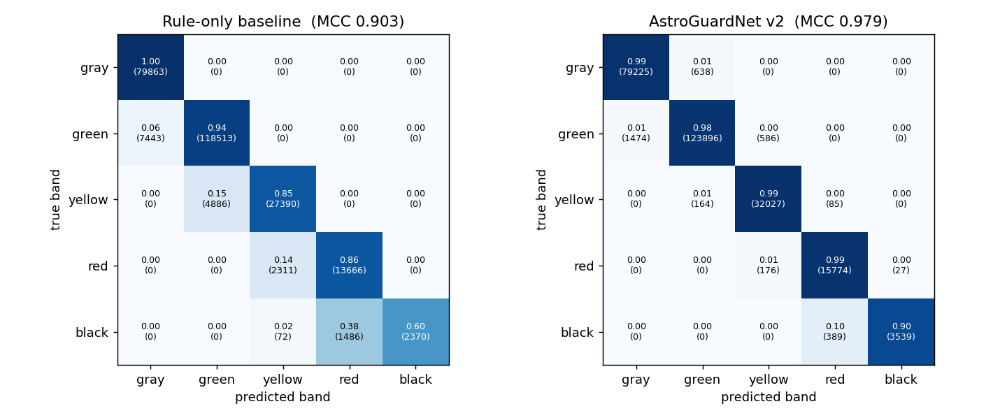
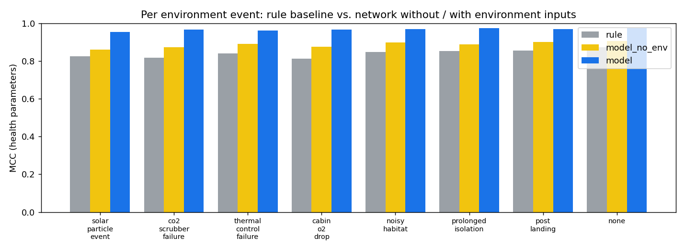

# AstroGuard-X v2 - held-out model evaluation

> Generated by `python -m models.evaluate`. All data are **simulated** crews (see `utils/synthetic_data.py`); the numbers measure agreement with the simulator's targets (reference ranges + physiological, symptom and environment interaction priors), **not clinical accuracy**.

## Test protocol

* **6,000 unseen crew-days** (seed `424242`, disjoint from training and validation seeds), 258,000 parameter-level predictions (43 parameters each).
* Band distribution of the test cells: gray 79,863, green 125,956, yellow 32,276, red 15,977, black 3,928 - strongly imbalanced, black is rare.
* 1000 bootstrap resamples of whole crew-days for 95 % confidence intervals; 16 Monte-Carlo samples per prediction.
* Model: `checkpoints\astroguard_v2.pt` - 1,717,362 parameters, trained on 32,000 simulated crew-days, best epoch 45 (cuda).

## Which metric and why

The dashboard assigns every parameter to one of five **ordered, imbalanced** colour bands. Accuracy alone would reward a model that never raises a black alarm, so:

| Metric | Role | Why it fits |
|---|---|---|
| **MCC** (multi-class Matthews) | **primary** | uses the whole confusion matrix, robust to class imbalance, high only if every band is predicted well |
| Macro-F1 | complementary | unweighted mean of per-band F1 - the rare black band counts as much as gray |
| Quadratic weighted kappa | complementary | the bands are ordinal; confusing gray with black is penalised far more than gray with green |
| Critical recall / under-triage | safety | share of true red/black cases flagged red/black, and share shown as gray/green/yellow (missed alarms) |
| Actionable F1 | operational | does the value correctly trigger AI mitigation tasks (yellow or worse)? |

## Headline results (all 43 parameters, test set)

| System | MCC [95 % CI] | Macro-F1 [95 % CI] | QWK | Critical recall | Under-triage | Actionable F1 | MAE (pp) |
|---|---|---|---|---|---|---|---|
| Rule-only (reference ranges) | 0.9032 [0.9016–0.9047] | 0.8839 [0.8808–0.8872] | 0.9599 | 0.8803 | 0.1197 | 0.9509 | 1.494 |
| Ridge residual (scikit-learn) | 0.9550 [0.9540–0.9560] | 0.9485 [0.9466–0.9504] | 0.9824 | 0.9890 | 0.0110 | 0.9775 | 0.622 |
| Ablation: v2 without environment inputs | 0.6569 [0.6551–0.6586] | 0.6390 [0.6343–0.6435] | 0.5122 | 0.3670 | 0.6330 | 0.6812 | 8.358 |
| **AstroGuardNet v2** | 0.9788 [0.9782–0.9796] | 0.9767 [0.9752–0.9781] | 0.9916 | 0.9912 | 0.0088 | 0.9928 | 0.274 |
| Deployed blend (0.20 rule + 0.80 model, safety floor) | 0.9680 [0.9672–0.9689] | 0.9570 [0.9548–0.9590] | 0.9872 | 0.9670 | 0.0330 | 0.9903 | 0.444 |

### Physiological health parameters only (31 biomarkers - fair environment ablation)

| System | MCC [95 % CI] | Macro-F1 [95 % CI] | QWK | Critical recall | Under-triage | Actionable F1 | MAE (pp) |
|---|---|---|---|---|---|---|---|
| Rule-only (reference ranges) | 0.8588 [0.8564–0.8609] | 0.7809 [0.7754–0.7868] | 0.9306 | 0.7286 | 0.2714 | 0.9120 | 2.061 |
| Ablation: v2 without environment inputs | 0.8977 [0.8959–0.8997] | 0.8527 [0.8478–0.8576] | 0.9515 | 0.8321 | 0.1679 | 0.9425 | 1.441 |
| Ridge residual (scikit-learn) | 0.9358 [0.9343–0.9372] | 0.9141 [0.9109–0.9170] | 0.9713 | 0.9792 | 0.0208 | 0.9621 | 0.837 |
| **AstroGuardNet v2** | 0.9701 [0.9692–0.9712] | 0.9611 [0.9584–0.9635] | 0.9864 | 0.9801 | 0.0199 | 0.9883 | 0.353 |
| Deployed blend (0.20 rule + 0.80 model, safety floor) | 0.9541 [0.9529–0.9553] | 0.9233 [0.9194–0.9270] | 0.9787 | 0.9253 | 0.0747 | 0.9836 | 0.593 |

### Is the improvement significant? (paired bootstrap of the difference)

| Comparison | Δ MCC 95 % CI | Δ Macro-F1 95 % CI | Δ critical recall 95 % CI | P(Δ MCC ≤ 0) |
|---|---|---|---|---|
| v2 − rule (all 43) | 0.0742 … 0.0772 | 0.0897 … 0.0956 | 0.1065 … 0.1154 | 0.000 |
| v2 − ridge (all 43) | 0.0228 … 0.0249 | 0.0261 … 0.0302 | 0.0006 … 0.0038 | 0.000 |
| v2 − v2 without environment (31 health params) | 0.0707 … 0.0742 | 0.1040 … 0.1128 | 0.1400 … 0.1562 | 0.000 |
| v2 − v2 without environment (all 43) | 0.3203 … 0.3238 | 0.3332 … 0.3423 | 0.6164 … 0.6323 | 0.000 |
| deployed − rule (all 43) | 0.0635 … 0.0661 | 0.0706 … 0.0755 | 0.0827 … 0.0907 | 0.000 |

## Network details

| Metric | Value |
|---|---|
| Health parameters: MCC / macro-F1 / QWK | 0.9701 / 0.9611 / 0.9864 |
| Environment parameters: MCC / macro-F1 | 0.9978 / 0.9980 |
| Overall health-risk band: MCC / macro-F1 / QWK | 0.9197 / 0.8614 / 0.9405 |
| Black-band recall | 0.9010 |
| Risk MAE / RMSE (percentage points) | 0.274 / 0.631 |
| Predictions within ±10 points | 0.9999 |
| 90 % credible-interval coverage | 0.9975 |
| 7-day forecast MAE (points) | 3.754 |
| Inference time per crew-day (GPU, batched) | 0.672 ms |

### Per-band precision / recall (all parameters)

| Band | Support | Rule recall | **v2 precision** | **v2 recall** | **v2 F1** |
|---|---|---|---|---|---|
| gray | 79,863 | 1.0000 | 0.9817 | 0.9920 | 0.9868 |
| green | 125,956 | 0.9409 | 0.9936 | 0.9836 | 0.9886 |
| yellow | 32,276 | 0.8486 | 0.9768 | 0.9923 | 0.9845 |
| red | 15,977 | 0.8554 | 0.9708 | 0.9873 | 0.9790 |
| black | 3,928 | 0.6034 | 0.9924 | 0.9010 | 0.9445 |

## Slice analysis - does the network use the environment?

MCC on the 31 health parameters per off-nominal environment event and per mission profile. `no-env` is the same network with all environment inputs neutralised.

| Event | n | Rule MCC | v2 no-env MCC | **v2 MCC** | Rule crit. recall | **v2 crit. recall** |
|---|---|---|---|---|---|---|
| solar_particle_event | 328 | 0.8242 | 0.8600 | **0.9533** | 0.8468 | **0.9870** |
| co2_scrubber_failure | 297 | 0.8183 | 0.8729 | **0.9667** | 0.6682 | **0.9673** |
| thermal_control_failure | 280 | 0.8410 | 0.8895 | **0.9619** | 0.6950 | **0.9622** |
| cabin_o2_drop | 298 | 0.8112 | 0.8744 | **0.9659** | 0.6198 | **0.9773** |
| noisy_habitat | 277 | 0.8483 | 0.8978 | **0.9696** | 0.6914 | **0.9814** |
| prolonged_isolation | 305 | 0.8523 | 0.8875 | **0.9746** | 0.6514 | **0.9748** |
| post_landing | 325 | 0.8538 | 0.9012 | **0.9677** | 0.6739 | **0.9862** |
| none | 3890 | 0.8716 | 0.9059 | **0.9727** | 0.7388 | **0.9813** |

| Mission profile | n | Rule MCC | v2 no-env MCC | **v2 MCC** | v2 MAE |
|---|---|---|---|---|---|
| Earth analog (HERA / Antarctic station) | 728 | 0.9128 | 0.9452 | **0.9793** | 0.258 |
| ISS - low Earth orbit | 1835 | 0.8684 | 0.9071 | **0.9754** | 0.282 |
| Lunar Gateway (cislunar orbit) | 710 | 0.8752 | 0.9146 | **0.9712** | 0.292 |
| Lunar surface habitat | 818 | 0.8742 | 0.9142 | **0.9740** | 0.298 |
| Mars transit (deep space) | 1061 | 0.8160 | 0.8530 | **0.9572** | 0.515 |
| Mars surface habitat | 848 | 0.8181 | 0.8644 | **0.9629** | 0.493 |

*scikit-learn cross-check (v2, all parameters):* MCC 0.978838, macro-F1 0.976674, QWK 0.991610 - identical to the NumPy implementation.
